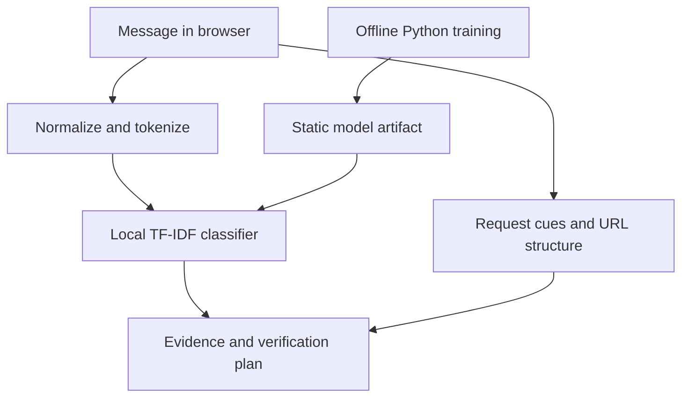

# SecondLook

**Check before you click. A private second look at suspicious messages.**


SecondLook helps readers pause before acting on a convincing text or email. A browser-based classifier, observable request cues, and link-structure checks show what deserves attention and lead to independent verification. The app never labels a message “safe.”

[Open the app](https://secondlook-forgehacks.vercel.app/) · [Demo player](https://secondlook-forgehacks.vercel.app/demo.html) · [Evaluation](docs/evaluation.json) · [Security](docs/security.md)

Built for **ForgeHacks Online 2026 — AI + Cybersecurity** by **Adeel Falak Sher and Raouf Khalid**.

## Try it

1. Choose **Scholarship fee** and select **Check this message**.
2. Review the payment, urgency, secrecy, and link observations.
3. Expand the model evidence, then open the verification guide.
4. Compare **Study group**: fewer detected cues still do not verify the sender.

No account, backend, API key, or paid inference service is required.

## Run locally

Use Python 3 to serve the application:

```sh
git clone https://github.com/adeelfalaksher900-creator/secondlook-forgehacks.git
cd secondlook-forgehacks
python3 -m http.server 4186 --directory public
```

Open **http://localhost:4186**. The committed model is ready to use.

## Architecture



| Component | Responsibility |
| --- | --- |
| `public/engine.js` | Normalization, TF-IDF inference, request cues, and URL observations |
| `public/app.js` | Input lifecycle, result rendering, and navigation |
| `public/model.json` | Vocabulary, weights, IDF values, and model metadata |
| `ml/train.py` | Reproducible training and artifact export |
| `tests/` | Prediction parity, behavior, browser, and accessibility checks |
| `vercel.json` | Deployment security-header configuration |
| `video/` | Demo composition and finishing scripts |

The browser loads static assets and runs inference locally. It does not fetch suspicious URLs. Results use literal text rendering, and changing the input clears stale results.

## Model

The classifier uses the **UCI SMS Spam Collection**, TF-IDF word unigrams and bigrams, and logistic regression. The training pipeline removes exact normalized duplicates before a stratified 80/20 split with seed 42.

| Dataset and model | Committed configuration |
| --- | ---: |
| Source rows | 5,574 |
| Unique normalized messages | 5,126 |
| Training / test messages | 4,100 / 1,026 |
| Learned features | 9,819 |
| Logistic regression C | 8 |

JavaScript mirrors the Python preprocessing and inference. The parity test checks every held-out prediction with a probability-difference threshold of `1e-10`.

Request cues separately inspect private access, payments, pressure, rewards, and secrecy. Link checks inspect structure without establishing ownership or reputation. Short, unfamiliar, and detected non-Latin input suppresses the model score; this is a heuristic scope check, not reliable language identification.

## Evaluation

The committed [evaluation report](docs/evaluation.json) records the following results at threshold 0.5 on held-out **historical English SMS spam**:

| Metric | Recorded result |
| --- | ---: |
| Spam precision | 97.17% |
| Spam recall | 81.75% |
| Spam F1 | 88.79% |
| Average precision | 97.19% |
| Brier score | 0.01814 |

| Actual class | Predicted ham | Predicted spam |
| --- | ---: | ---: |
| Ham | 897 | 3 |
| Spam | 23 | 103 |

These evaluate the classifier, not the combined workflow or real-world fraud prevention. Near-duplicate templates may remain across splits. Modern phishing, unsupported languages, quoted or negated requests, and domain shift remain important failure cases.

## Verify

Use Node.js 22+ for the development checks:

```sh
npm test
npm install
npx playwright install chromium
```

With the local application server running in another terminal:

```sh
npm run test:browser
npm run test:a11y
```

Set `SECONDLOOK_BROWSER_PATH` only when supplying a custom Chromium executable. Browser scripts also write inspection captures and reports. Committed [browser results](docs/browser-checks.json) record 12 checks; [accessibility results](docs/accessibility.json) record no automated violations in four inspected states. These are targeted checks, not a comprehensive security audit or accessibility certification.

## Reproduce training

```sh
python3 -m pip install -r ml/requirements.txt
curl -L 'https://archive.ics.uci.edu/static/public/228/sms%2Bspam%2Bcollection.zip' -o ml/sms.zip
python3 ml/train.py
npm test
```

Training regenerates `public/model.json`, `docs/evaluation.json`, and `tests/parity.json`. Dataset files and derived examples retain their original dataset attribution and license.

## Deploy

Publish the `public/` directory as a static site. On Vercel, use `public` as the output directory and retain the repository's `vercel.json` header configuration. Verify live headers after deployment.

There are no runtime npm dependencies. Training and browser-test dependencies are separate from the delivered app.

## Privacy and scope

Messages are not saved by the app or sent to an inference API. The runtime uses no browser storage, analytics, cookies, or message telemetry. The hosting provider still receives ordinary asset requests; browser extensions and device security sit outside the app's boundary.

A spam-pattern score does not establish authenticity, malicious intent, or safety. The app has not demonstrated fraud reduction or measured user outcomes. Its next step is consented usability testing and evaluation against a modern independently labeled dataset.

## Project docs

- [Security review and residual risks](docs/security.md)
- [Evaluation method and metrics](docs/evaluation.json)
- [Third-party licenses and media provenance](docs/third-party.md)
- [Publication record](docs/publishing.json)
- [Judging review](docs/judging-review.md)
- [Video composition](video/)

<details>
<summary>Reproduce the visual demo</summary>

Run the capture from the repository root with the app server running and development dependencies installed:

```sh
node tests/record.cjs
ffmpeg -i video/assets/workflow.webm -vf "crop=1440:810:0:0,scale=1920:1080:flags=lanczos,fps=30,tpad=stop_mode=clone:stop_duration=1" -t 160 -c:v libx264 -crf 18 -g 30 -keyint_min 30 -movflags +faststart video/assets/workflow.mp4
npx --yes hyperframes@0.8.141 check video
npx --yes hyperframes@0.8.141 render video --fps 30 --quality high --output media/SecondLook_Visual_Demo_1080p.mp4
```

Video binaries are separate release artifacts. Local playback expects `public/demo.mp4` and `public/demo-poster.png`. The finishing scripts expect their original master and narration inputs; see the retained source and provenance record before reproducing the narrated edit.

</details>

## Contribute

Use focused pull requests and run the relevant checks. Include dataset or model provenance when changing inference, and keep private messages and credentials out of issues, fixtures, and commits.

## License

Project code uses [MIT](LICENSE). The **UCI SMS Spam Collection** is attributed to Almeida and Hidalgo (2011), DOI [10.24432/C5CC84](https://doi.org/10.24432/C5CC84), under **CC BY 4.0**. Dataset-derived fixtures retain that attribution. Third-party tooling and media use their respective terms, recorded in [docs/third-party.md](docs/third-party.md).

